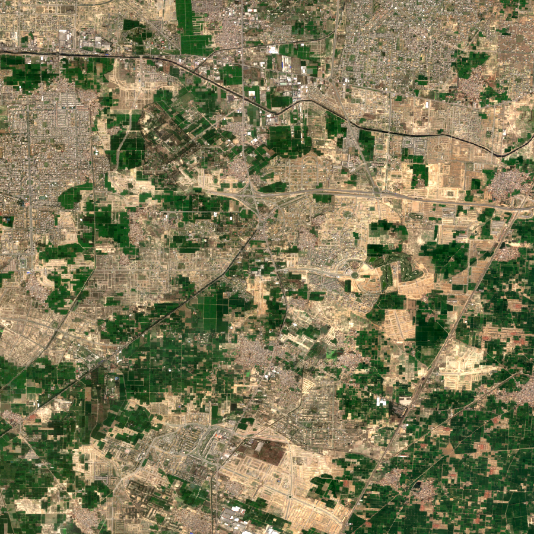
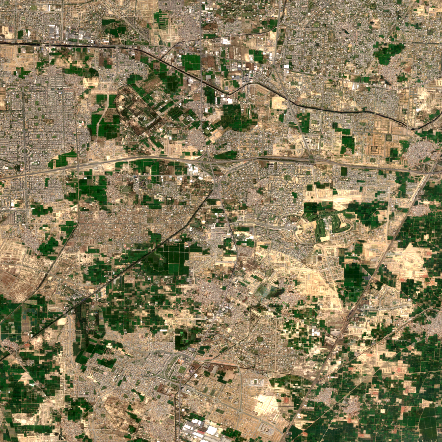
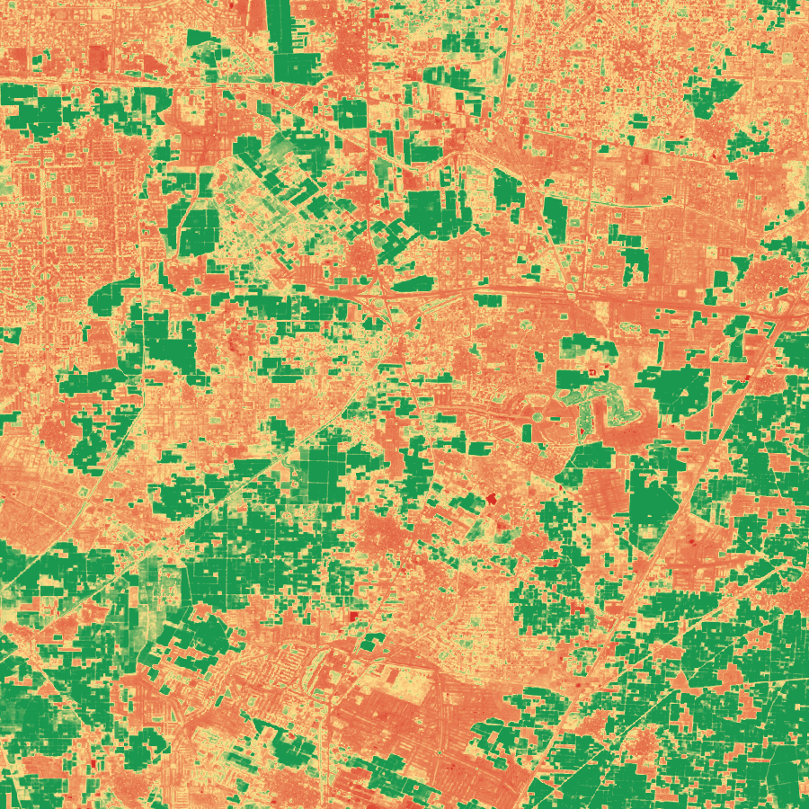
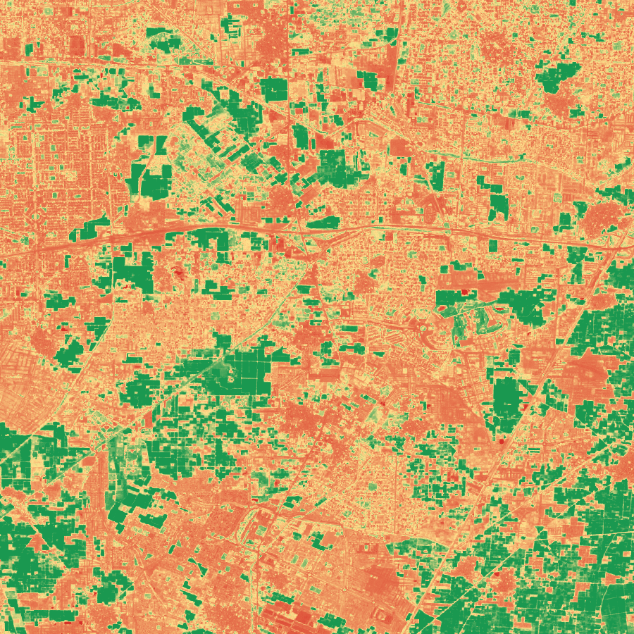
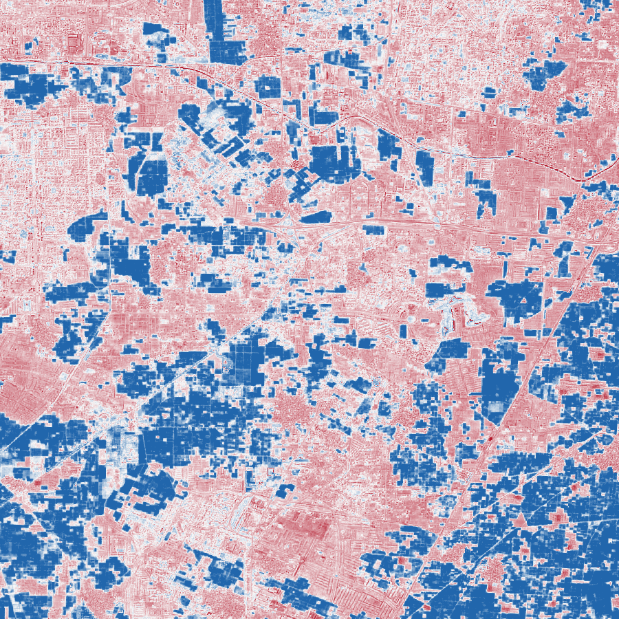
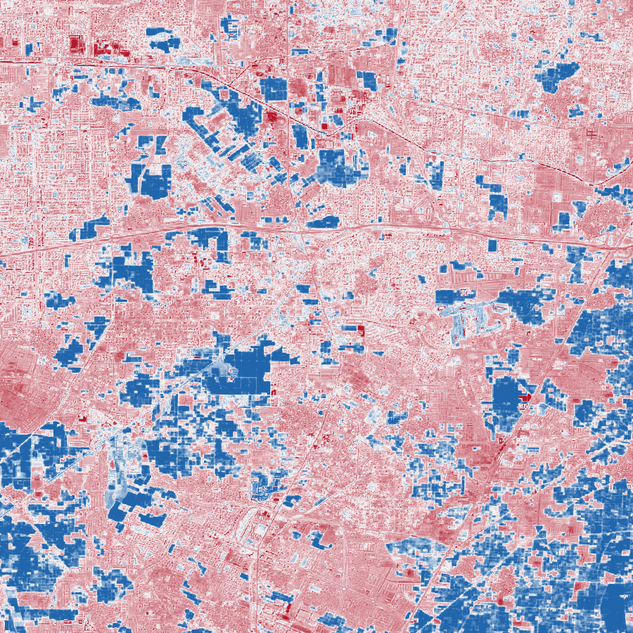
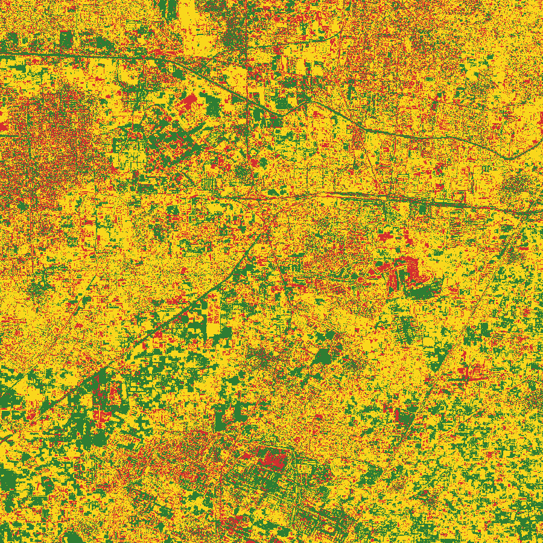
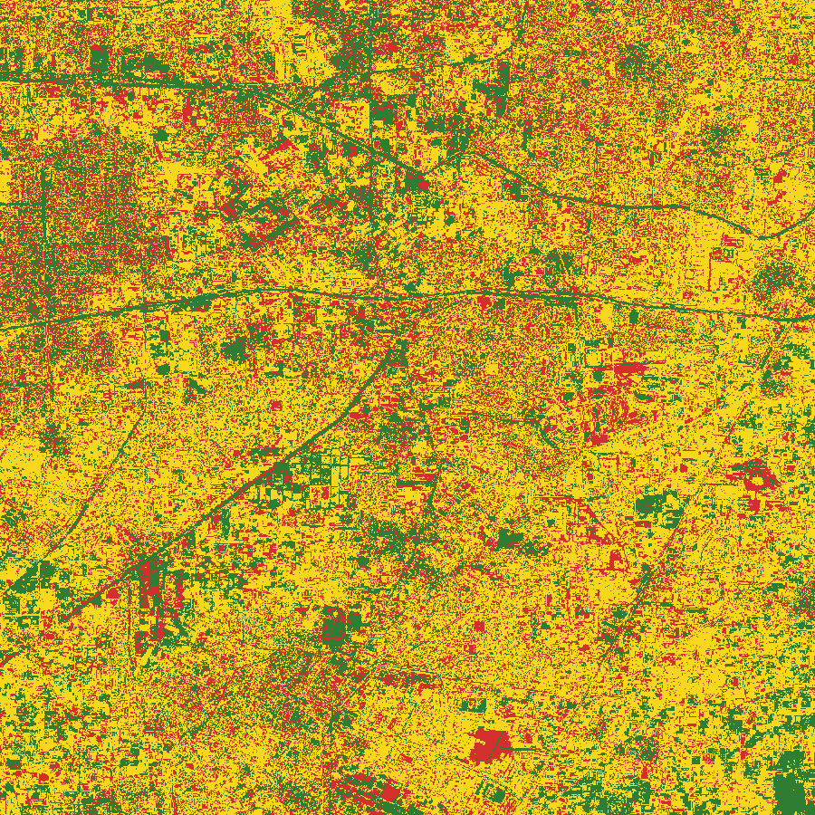
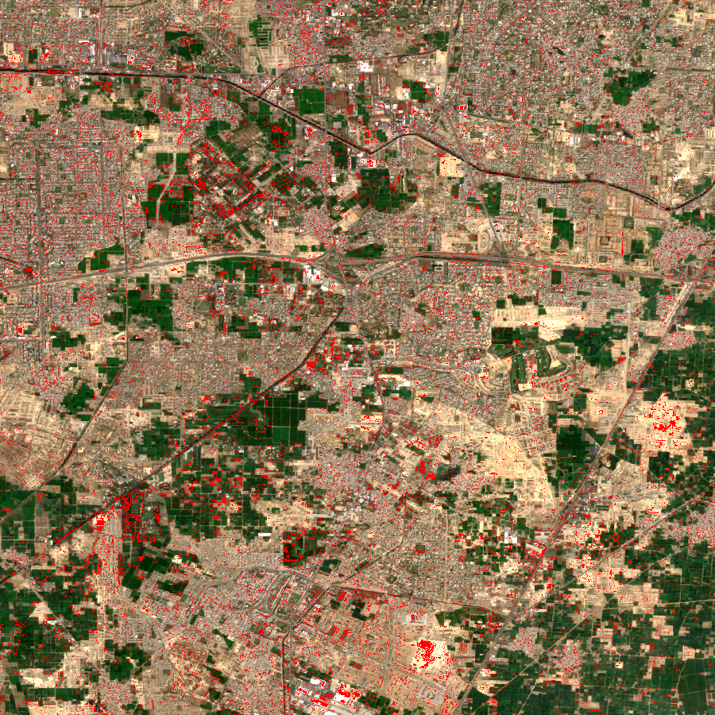
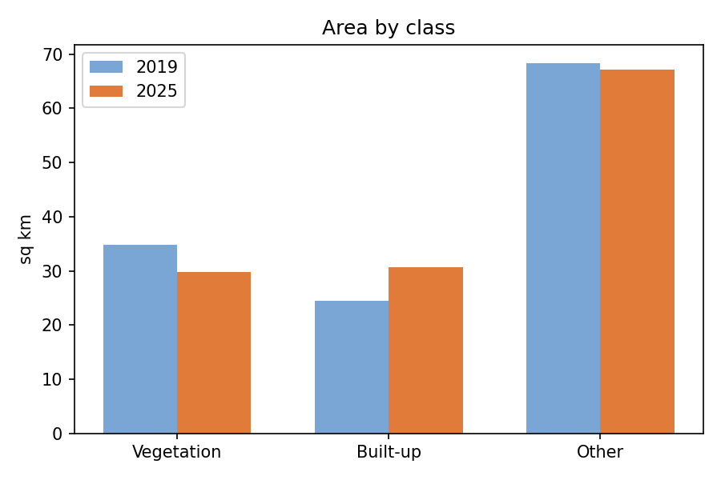

# Punjab GeoGuardian – Detecting Urban Expansion and Farmland Loss Using Sentinel-2

> Learning prototype – not an official government monitoring system. All results are *estimated* / *possible* changes.

## 1. Project Overview
This project uses satellite imagery to detect possible urban expansion and farmland loss in **Lahore peri-urban zone (Raiwind Road corridor)**. Sentinel-2 images of 2019 and 2025 are compared, vegetation and built-up indices are computed, land cover is classified, and areas where vegetation/agriculture appears to have changed into built-up land are highlighted and measured. Outputs: maps, area statistics, an interactive map and a dashboard.

## 2. Tools and Technologies
Python, Google Colab, Google Earth Engine, Sentinel-2 SR Harmonized, geemap/Folium, Pandas, NumPy, Matplotlib, Scikit-learn, Random Forest (Earth Engine), Streamlit.

## 3. Area and Data Selection
- **AOI:** Lahore peri-urban zone (Raiwind Road corridor), bounding box [74.18, 31.3, 74.29, 31.41] (≈ 127.76 sq km). A peri-urban belt of Lahore with active housing/commercial development on former farmland.
- **Years:** 2019 (2019-01-15 to 2019-03-31, 13 scenes) and 2025 (2025-01-15 to 2025-03-31, 17 scenes).
- **Satellite:** Sentinel-2 Level-2A (10 m), scene cloud filter < 20%, SCL pixel-level cloud/shadow mask, median composite. Same season used in both years to reduce crop-calendar effects.

## 4. Remote-Sensing Concepts
**NDVI** = (NIR − Red) / (NIR + Red) (Sentinel-2: B8, B4). Healthy vegetation reflects strongly in NIR and absorbs red light, so high NDVI usually means crops/vegetation.

**NDBI** = (SWIR − NIR) / (SWIR + NIR) (B11, B8). Built-up surfaces reflect more SWIR than NIR, so higher NDBI often indicates built-up land (bare soil can also give high values).

**Change detection** compares classified maps of two dates: pixels that were *Vegetation/Agriculture* in 2019 and *Built-up* in 2025 are marked as possible agricultural-to-urban conversion.

## 5. Methodology
AOI selection → Sentinel-2 loading → date + cloud filtering → median composite & clip → RGB → NDVI/NDBI/MNDWI → classification (Random Forest (200 trees; features: B2, B3, B4, B8, B11, NDVI, NDBI), trained on 196 manually labelled points from 2025) → change detection → area calculation (pixel area, 10 m) → hotspot grid (1 km cells) → maps/dashboard → validation → error analysis.
Thresholds used for the baseline rules: {'ndvi_veg': 0.35, 'ndvi_built_max': 0.25, 'ndbi_built': -0.02, 'mndwi_water': 0.1}.

## 6. Results
| Metric | Value |
|---|---|
| Total AOI area (sq km) | 127.76 |
| Valid (cloud-free in both years) area (sq km) | 127.65 |
| Vegetation/Agriculture area 2019 (sq km) | 34.84 |
| Vegetation/Agriculture area 2025 (sq km) | 29.79 |
| Built-up area 2019 (sq km) | 24.5 |
| Built-up area 2025 (sq km) | 30.68 |
| Other area 2019 (sq km) | 68.31 |
| Other area 2025 (sq km) | 67.17 |
| Possible agriculture-to-urban conversion (sq km) | 7.24 |
| % of AOI affected | 5.67 |
| % of 2019 vegetation possibly converted | 20.78 |
| Built-up → vegetation (likely noise) (sq km) | 5.1 |

 

 

 

 

 

**Top hotspot cells (1 sq km grid):**

|   rank |    lon |        lat |   conversion_sq_km |   pct_of_1sqkm_cell |
|-------:|-------:|-----------:|-------------------:|--------------------:|
|      1 | 423400 | 3.4664e+06 |              0.135 |                13.5 |
|      2 | 428400 | 3.4644e+06 |              0.109 |                10.9 |
|      3 | 423400 | 3.4654e+06 |              0.106 |                10.6 |
|      4 | 424400 | 3.4734e+06 |              0.102 |                10.2 |
|      5 | 426400 | 3.4634e+06 |              0.101 |                10.1 |
|      6 | 425400 | 3.4714e+06 |              0.096 |                 9.6 |
|      7 | 425400 | 3.4724e+06 |              0.09  |                 9   |
|      8 | 428400 | 3.4674e+06 |              0.089 |                 8.9 |
|      9 | 426400 | 3.4644e+06 |              0.089 |                 8.9 |
|     10 | 424400 | 3.4664e+06 |              0.086 |                 8.6 |

## 7. Validation
59 manually checked points (stratified random, checked against Google high-resolution satellite basemap; not used for training). Correct: 19, incorrect: 40, **approximate accuracy: 32.2%**, Cohen's kappa 0.038. Full table: `validation_results.csv`.

|   Point ID | Actual                 | Predicted              | Result    | Notes       |
|-----------:|:-----------------------|:-----------------------|:----------|:------------|
|          1 | Vegetation/Agriculture | Other                  | Incorrect | crop field  |
|          2 | Vegetation/Agriculture | Other                  | Incorrect | crop field  |
|          3 | Vegetation/Agriculture | Vegetation/Agriculture | Correct   | crop field  |
|          4 | Vegetation/Agriculture | Built-up/Urban         | Incorrect | crop field  |
|          5 | Vegetation/Agriculture | Other                  | Incorrect | crop field  |
|          6 | Vegetation/Agriculture | Vegetation/Agriculture | Correct   | crop field  |
|          7 | Vegetation/Agriculture | Built-up/Urban         | Incorrect | crop field  |
|          8 | Vegetation/Agriculture | Built-up/Urban         | Incorrect | crop field  |
|          9 | Vegetation/Agriculture | Other                  | Incorrect | crop field  |
|         10 | Vegetation/Agriculture | Other                  | Incorrect | crop field  |
|         11 | Vegetation/Agriculture | Vegetation/Agriculture | Correct   | crop field  |
|         12 | Vegetation/Agriculture | Other                  | Incorrect | crop field  |
|         13 | Vegetation/Agriculture | Other                  | Incorrect | crop field  |
|         14 | Vegetation/Agriculture | Other                  | Incorrect | crop field  |
|         15 | Vegetation/Agriculture | Other                  | Incorrect | crop field  |
|         16 | Built-up/Urban         | Other                  | Incorrect | housingarea |
|         17 | Built-up/Urban         | Other                  | Incorrect | housingarea |
|         18 | Built-up/Urban         | Vegetation/Agriculture | Incorrect | housingarea |
|         19 | Built-up/Urban         | Built-up/Urban         | Correct   | housingarea |
|         20 | Built-up/Urban         | Built-up/Urban         | Correct   | housingarea |
|         21 | Built-up/Urban         | Vegetation/Agriculture | Incorrect | housingarea |
|         22 | Built-up/Urban         | Vegetation/Agriculture | Incorrect | housingarea |
|         23 | Built-up/Urban         | Other                  | Incorrect | housingarea |
|         24 | Built-up/Urban         | Other                  | Incorrect | housingarea |
|         25 | Built-up/Urban         | Other                  | Incorrect | housingarea |
|         26 | Built-up/Urban         | Other                  | Incorrect | housingarea |
|         27 | Built-up/Urban         | Built-up/Urban         | Correct   | housingarea |
|         28 | Built-up/Urban         | Built-up/Urban         | Correct   | housingarea |
|         29 | Built-up/Urban         | Vegetation/Agriculture | Incorrect | housingarea |
|         30 | Built-up/Urban         | Other                  | Incorrect | housingarea |
|         31 | Built-up/Urban         | Built-up/Urban         | Correct   | housingarea |
|         32 | Other                  | Other                  | Correct   | baresoil    |
|         33 | Other                  | Other                  | Correct   | baresoil    |
|         34 | Other                  | Other                  | Correct   | baresoil    |
|         35 | Other                  | Built-up/Urban         | Incorrect | baresoil    |
|         36 | Other                  | Vegetation/Agriculture | Incorrect | baresoil    |
|         37 | Other                  | Vegetation/Agriculture | Incorrect | baresoil    |
|         38 | Other                  | Built-up/Urban         | Incorrect | baresoil    |
|         39 | Other                  | Other                  | Correct   | baresoil    |
|         40 | Other                  | Built-up/Urban         | Incorrect | baresoil    |
|         41 | Vegetation/Agriculture | Other                  | Incorrect | crop field  |
|         42 | Vegetation/Agriculture | Other                  | Incorrect | crop field  |
|         43 | Vegetation/Agriculture | Built-up/Urban         | Incorrect | crop field  |
|         44 | Vegetation/Agriculture | Other                  | Incorrect | crop field  |
|         45 | Vegetation/Agriculture | Other                  | Incorrect | crop field  |
|         46 | Vegetation/Agriculture | Built-up/Urban         | Incorrect | crop field  |
|         47 | Vegetation/Agriculture | Vegetation/Agriculture | Correct   | crop field  |
|         48 | Vegetation/Agriculture | Vegetation/Agriculture | Correct   | crop field  |
|         49 | Vegetation/Agriculture | Vegetation/Agriculture | Correct   | crop field  |
|         50 | Vegetation/Agriculture | Vegetation/Agriculture | Correct   | crop field  |
|         51 | Vegetation/Agriculture | Other                  | Incorrect | crop field  |
|         52 | Vegetation/Agriculture | Other                  | Incorrect | crop field  |
|         53 | Vegetation/Agriculture | Vegetation/Agriculture | Correct   | crop field  |
|         54 | Vegetation/Agriculture | Other                  | Incorrect | crop field  |
|         55 | Vegetation/Agriculture | Other                  | Incorrect | crop field  |
|         56 | Vegetation/Agriculture | Vegetation/Agriculture | Correct   | crop field  |
|         57 | Vegetation/Agriculture | Built-up/Urban         | Incorrect | crop field  |
|         58 | Vegetation/Agriculture | Other                  | Incorrect | crop field  |
|         59 | Vegetation/Agriculture | Vegetation/Agriculture | Correct   | crop field  |

## 8. Error Analysis
49 weak/incorrect cases were reviewed (table below, full list in `error_analysis.csv`).

|   point_id | Actual                 | Predicted              | Error type                              |   NDVI |   NDBI | notes       | Possible reason (VERIFY & rewrite)                                                             |
|-----------:|:-----------------------|:-----------------------|:----------------------------------------|-------:|-------:|:------------|:-----------------------------------------------------------------------------------------------|
|          1 | Vegetation/Agriculture | Other                  | Vegetation/Agriculture → Other          |  0.698 | -0.169 | crop field  | Sparse crop/young crop or mixed pixel -> NDVI below vegetation threshold                       |
|         43 | Vegetation/Agriculture | Built-up/Urban         | Vegetation/Agriculture → Built-up/Urban |  0.522 | -0.117 | crop field  | Dry/fallow field or bare soil looks like built-up (low NDVI, high NDBI); harvest-season change |
|         30 | Built-up/Urban         | Other                  | Built-up/Urban → Other                  |  0.379 | -0.102 | housingarea | Small buildings or new roads missed; 10 m mixed pixels                                         |
|         35 | Other                  | Built-up/Urban         | Other → Built-up/Urban                  |  0.299 |  0.055 | baresoil    | Barren/sandy soil or dry channel confused with built-up                                        |
|         36 | Other                  | Vegetation/Agriculture | Other → Vegetation/Agriculture          |  0.093 |  0.092 | baresoil    | Seasonal grass/scrub classified as vegetation                                                  |
|         37 | Other                  | Vegetation/Agriculture | Other → Vegetation/Agriculture          |  0.069 |  0.091 | baresoil    | Seasonal grass/scrub classified as vegetation                                                  |
|         38 | Other                  | Built-up/Urban         | Other → Built-up/Urban                  |  0.486 | -0.13  | baresoil    | Barren/sandy soil or dry channel confused with built-up                                        |
|         40 | Other                  | Built-up/Urban         | Other → Built-up/Urban                  |  0.56  | -0.174 | baresoil    | Barren/sandy soil or dry channel confused with built-up                                        |
|         41 | Vegetation/Agriculture | Other                  | Vegetation/Agriculture → Other          |  0.316 | -0.091 | crop field  | Sparse crop/young crop or mixed pixel -> NDVI below vegetation threshold                       |
|         42 | Vegetation/Agriculture | Other                  | Vegetation/Agriculture → Other          |  0.121 |  0.064 | crop field  | Sparse crop/young crop or mixed pixel -> NDVI below vegetation threshold                       |
|         44 | Vegetation/Agriculture | Other                  | Vegetation/Agriculture → Other          |  0.275 | -0.009 | crop field  | Sparse crop/young crop or mixed pixel -> NDVI below vegetation threshold                       |
|         26 | Built-up/Urban         | Other                  | Built-up/Urban → Other                  |  0.254 |  0.088 | housingarea | Small buildings or new roads missed; 10 m mixed pixels                                         |
|         45 | Vegetation/Agriculture | Other                  | Vegetation/Agriculture → Other          |  0.329 |  0.118 | crop field  | Sparse crop/young crop or mixed pixel -> NDVI below vegetation threshold                       |
|         46 | Vegetation/Agriculture | Built-up/Urban         | Vegetation/Agriculture → Built-up/Urban |  0.568 | -0.082 | crop field  | Dry/fallow field or bare soil looks like built-up (low NDVI, high NDBI); harvest-season change |
|         51 | Vegetation/Agriculture | Other                  | Vegetation/Agriculture → Other          |  0.34  | -0.028 | crop field  | Sparse crop/young crop or mixed pixel -> NDVI below vegetation threshold                       |
|         52 | Vegetation/Agriculture | Other                  | Vegetation/Agriculture → Other          |  0.392 | -0.072 | crop field  | Sparse crop/young crop or mixed pixel -> NDVI below vegetation threshold                       |
|         54 | Vegetation/Agriculture | Other                  | Vegetation/Agriculture → Other          |  0.299 |  0.051 | crop field  | Sparse crop/young crop or mixed pixel -> NDVI below vegetation threshold                       |
|         55 | Vegetation/Agriculture | Other                  | Vegetation/Agriculture → Other          |  0.788 | -0.346 | crop field  | Sparse crop/young crop or mixed pixel -> NDVI below vegetation threshold                       |
|         57 | Vegetation/Agriculture | Built-up/Urban         | Vegetation/Agriculture → Built-up/Urban |  0.088 |  0.09  | crop field  | Dry/fallow field or bare soil looks like built-up (low NDVI, high NDBI); harvest-season change |
|         58 | Vegetation/Agriculture | Other                  | Vegetation/Agriculture → Other          |  0.242 |  0.088 | crop field  | Sparse crop/young crop or mixed pixel -> NDVI below vegetation threshold                       |
|          2 | Vegetation/Agriculture | Other                  | Vegetation/Agriculture → Other          |  0.272 |  0.051 | crop field  | Sparse crop/young crop or mixed pixel -> NDVI below vegetation threshold                       |
|         29 | Built-up/Urban         | Vegetation/Agriculture | Built-up/Urban → Vegetation/Agriculture |  0.248 |  0.153 | housingarea | Tree-covered housing area / park or mixed pixel classified as vegetation                       |
|         25 | Built-up/Urban         | Other                  | Built-up/Urban → Other                  |  0.109 |  0.082 | housingarea | Small buildings or new roads missed; 10 m mixed pixels                                         |
|         16 | Built-up/Urban         | Other                  | Built-up/Urban → Other                  |  0.217 |  0.064 | housingarea | Small buildings or new roads missed; 10 m mixed pixels                                         |
|          4 | Vegetation/Agriculture | Built-up/Urban         | Vegetation/Agriculture → Built-up/Urban |  0.327 |  0.149 | crop field  | Dry/fallow field or bare soil looks like built-up (low NDVI, high NDBI); harvest-season change |
|          5 | Vegetation/Agriculture | Other                  | Vegetation/Agriculture → Other          |  0.323 | -0.009 | crop field  | Sparse crop/young crop or mixed pixel -> NDVI below vegetation threshold                       |
|          7 | Vegetation/Agriculture | Built-up/Urban         | Vegetation/Agriculture → Built-up/Urban |  0.094 | -0.004 | crop field  | Dry/fallow field or bare soil looks like built-up (low NDVI, high NDBI); harvest-season change |
|          8 | Vegetation/Agriculture | Built-up/Urban         | Vegetation/Agriculture → Built-up/Urban |  0.115 |  0.015 | crop field  | Dry/fallow field or bare soil looks like built-up (low NDVI, high NDBI); harvest-season change |
|          9 | Vegetation/Agriculture | Other                  | Vegetation/Agriculture → Other          |  0.212 |  0.119 | crop field  | Sparse crop/young crop or mixed pixel -> NDVI below vegetation threshold                       |
|         10 | Vegetation/Agriculture | Other                  | Vegetation/Agriculture → Other          |  0.264 |  0.008 | crop field  | Sparse crop/young crop or mixed pixel -> NDVI below vegetation threshold                       |
|         12 | Vegetation/Agriculture | Other                  | Vegetation/Agriculture → Other          |  0.136 |  0.084 | crop field  | Sparse crop/young crop or mixed pixel -> NDVI below vegetation threshold                       |
|         13 | Vegetation/Agriculture | Other                  | Vegetation/Agriculture → Other          |  0.864 | -0.41  | crop field  | Sparse crop/young crop or mixed pixel -> NDVI below vegetation threshold                       |
|         15 | Vegetation/Agriculture | Other                  | Vegetation/Agriculture → Other          |  0.164 |  0.026 | crop field  | Sparse crop/young crop or mixed pixel -> NDVI below vegetation threshold                       |
|         14 | Vegetation/Agriculture | Other                  | Vegetation/Agriculture → Other          |  0.246 | -0.034 | crop field  | Sparse crop/young crop or mixed pixel -> NDVI below vegetation threshold                       |
|         17 | Built-up/Urban         | Other                  | Built-up/Urban → Other                  |  0.532 | -0.138 | housingarea | Small buildings or new roads missed; 10 m mixed pixels                                         |
|         18 | Built-up/Urban         | Vegetation/Agriculture | Built-up/Urban → Vegetation/Agriculture |  0.066 |  0     | housingarea | Tree-covered housing area / park or mixed pixel classified as vegetation                       |
|         21 | Built-up/Urban         | Vegetation/Agriculture | Built-up/Urban → Vegetation/Agriculture |  0.256 | -0.005 | housingarea | Tree-covered housing area / park or mixed pixel classified as vegetation                       |
|         22 | Built-up/Urban         | Vegetation/Agriculture | Built-up/Urban → Vegetation/Agriculture |  0.305 | -0.225 | housingarea | Tree-covered housing area / park or mixed pixel classified as vegetation                       |
|         23 | Built-up/Urban         | Other                  | Built-up/Urban → Other                  |  0.307 |  0.078 | housingarea | Small buildings or new roads missed; 10 m mixed pixels                                         |
|         24 | Built-up/Urban         | Other                  | Built-up/Urban → Other                  |  0.269 |  0.095 | housingarea | Small buildings or new roads missed; 10 m mixed pixels                                         |
|         28 | Built-up/Urban         | Built-up/Urban         | Borderline (weak) case                  |  0.273 |  0.036 | housingarea | NDVI/NDBI very close to threshold; mixed pixel or seasonal effect                              |
|         11 | Vegetation/Agriculture | Vegetation/Agriculture | Borderline (weak) case                  |  0.201 |  0.123 | crop field  | NDVI/NDBI very close to threshold; mixed pixel or seasonal effect                              |
|         48 | Vegetation/Agriculture | Vegetation/Agriculture | Borderline (weak) case                  |  0.242 | -0.018 | crop field  | NDVI/NDBI very close to threshold; mixed pixel or seasonal effect                              |
|         50 | Vegetation/Agriculture | Vegetation/Agriculture | Borderline (weak) case                  |  0.208 |  0.117 | crop field  | NDVI/NDBI very close to threshold; mixed pixel or seasonal effect                              |
|         34 | Other                  | Other                  | Borderline (weak) case                  |  0.135 |  0.003 | baresoil    | NDVI/NDBI very close to threshold; mixed pixel or seasonal effect                              |
|         33 | Other                  | Other                  | Borderline (weak) case                  |  0.349 | -0.015 | baresoil    | NDVI/NDBI very close to threshold; mixed pixel or seasonal effect                              |
|         31 | Built-up/Urban         | Built-up/Urban         | Borderline (weak) case                  |  0.179 | -0.039 | housingarea | NDVI/NDBI very close to threshold; mixed pixel or seasonal effect                              |
|          6 | Vegetation/Agriculture | Vegetation/Agriculture | Borderline (weak) case                  |  0.097 |  0.002 | crop field  | NDVI/NDBI very close to threshold; mixed pixel or seasonal effect                              |
|         59 | Vegetation/Agriculture | Vegetation/Agriculture | Borderline (weak) case                  |  0.42  | -0.038 | crop field  | NDVI/NDBI very close to threshold; mixed pixel or seasonal effect                              |

**Suggested improvements:** (1) more and better-distributed training samples; (2) multi-season / same-month composites and stricter cloud filtering; (3) higher-resolution imagery or a U-Net segmentation model; (4) more land classes (water, barren, roads); (5) validate against official housing-scheme/land-use data; (6) use more than two years.

## 9. Limitations
10 m pixels mix surfaces; dry fields/bare soil can look like built-up; tree-covered housing can look like vegetation; accuracy depends on dates, cloud masking, thresholds and sample quality. Results show *possible conversion* only and make no claim about any specific society or owner.

## 10. What I Learned
Using satellite imagery in AI projects, selecting an AOI, NDVI/NDBI, land classification, change detection, area estimation and map-based outputs.
